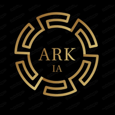
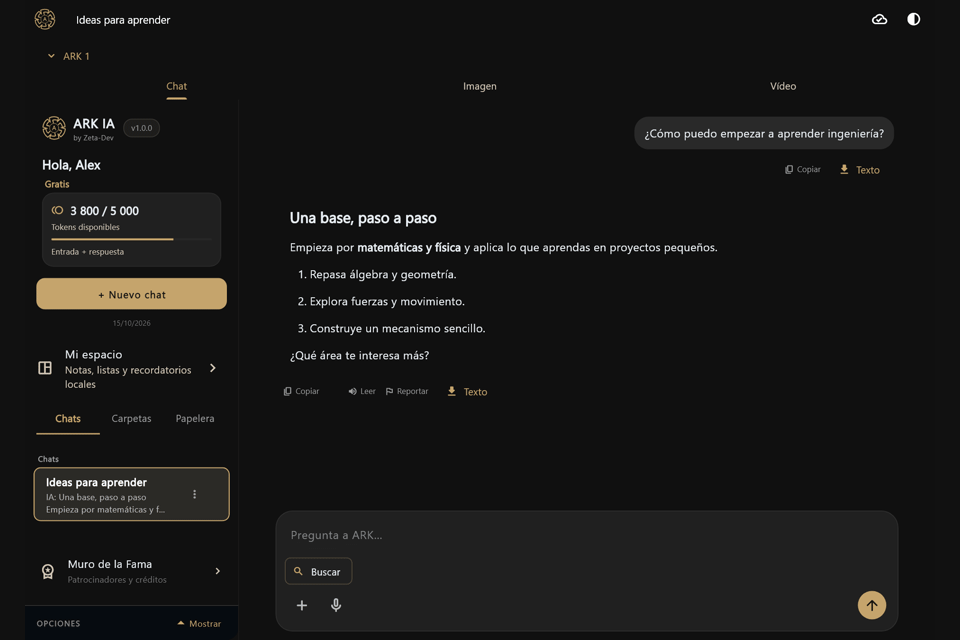
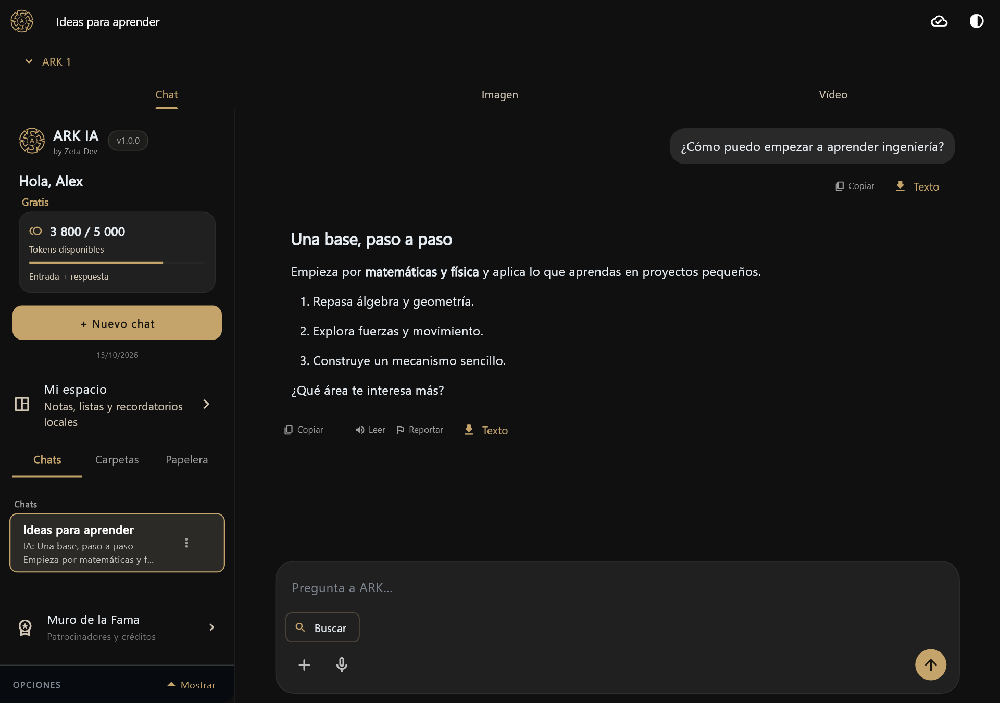
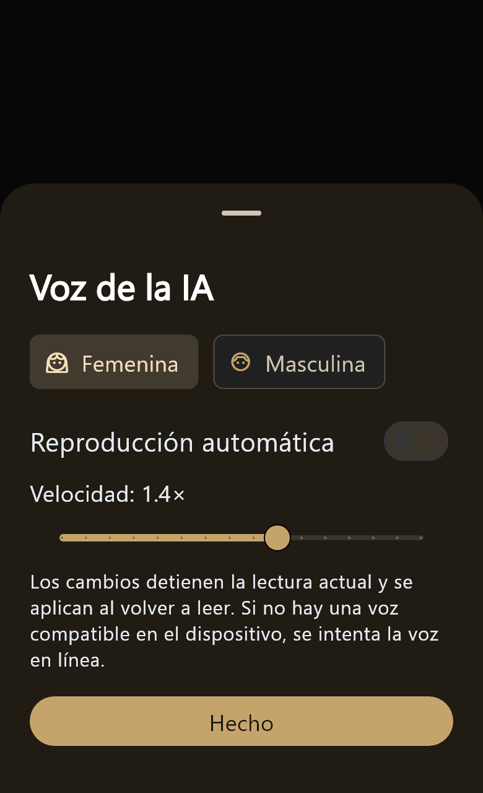
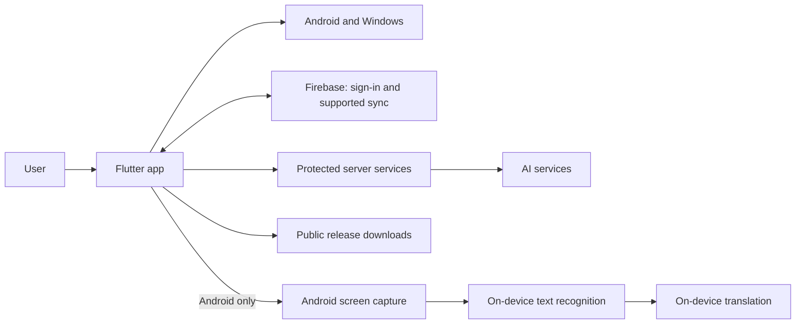

# ARK IA

### An independent Flutter project for Android and Windows

**A personal workspace for AI, voice, notes, and screen translation.**

[Deutsch](README.md) · [English](README.en.md) · [Español](README.es.md) · [Portfolio website](https://zetadevofficial-creator.github.io/ARK-IA-Portfolio/) · [Product site](https://ark-ia.web.app/) · [Downloads](https://ark-ia.web.app/#descargas)

---

## The project

ARK IA is an independently developed application. It combines AI conversations with voice tools, personal organization, and—on Android—screen text translation. It began as a Kotlin app and later moved to Flutter for Android and Windows.

This public repository is a **technical portfolio and project overview**. It intentionally does not contain the complete app source or private server logic.

The documentation is complemented by a [trilingual portfolio site](site/index.html), prepared for GitHub Pages. Its language selector offers German, English, and Spanish, and the site presents product views, a simplified architecture, and a selected Flutter example.

After GitHub Pages is enabled, GitHub Actions updates the site when files under `site/` change.

## Features

- AI conversations with formatted answers and available models.
- A personal workspace for chats, folders, notes, lists, and reminders.
- Voice input and read-aloud for responses.
- Sign-in and synchronization for supported account data.
- Android screen translation: user-triggered capture, text recognition, and on-device translation with downloaded language models.
- Separate Android and Windows releases, with update notices in the app.

Some features depend on platform, permissions, connectivity, or available services. In this version, screen translation is available on Android only.

## Project snapshot

| Area | Current snapshot |
| --- | --- |
| App version | 1.0.0 |
| Android build when this portfolio was prepared | 29 |
| Target platforms | Android (ARM64) and Windows (desktop) |
| Current UI stack | Flutter and Dart; the project began as a Kotlin prototype |
| Main code areas | `lib/`, `android/`, `windows/`, `assets/`, `test/`, and `tool/` |

The build number is a point-in-time reference and will be updated with future releases.

## Screenshots

  

More screenshots

  

  

## Technical overview

The diagram shows high-level system boundaries. It does not document internal endpoints, data formats, access rules, or operational details.

The [screen translation case study](docs/TECHNISCHE-FALLSTUDIE.md) explains one Android-specific design challenge without publishing core implementation details. The [development process](docs/DEVELOPMENT-PROCESS.md) describes the real high-level structure of the private project and the way I work.

## Selected code example

The standalone package in [`examples/flutter_interaction/`](examples/flutter_interaction/) contains a reusable Flutter widget with a subtle press animation and widget tests. It is real, limited UI code; it does not include authentication, synchronization, or AI services. Run its tests with `flutter test` from that directory.

## Development and quality

The project is developed with Flutter and Dart. The private app separates configuration, models, screens, services, widgets, theme, and utilities. Android and Windows integrations live in their platform areas. I use formatting, static analysis, and automated tests for changes; specific results are published only after being rerun locally. The [development process and project structure](docs/DEVELOPMENT-PROCESS.md) describe these practices.

## What this repository does not contain

- The complete application source or the full history of internal builds.
- Server code, administration panels, internal APIs, or private product and quota logic.
- API keys, signing keys, tokens, Firebase Admin credentials, or local configuration files.
- Local build outputs, private backups, or user and database data.

Public installers are available from the [ARK product page](https://ark-ia.web.app/#descargas). The complete Flutter source remains in a private repository.

## Links

- [ARK IA product page and downloads](https://ark-ia.web.app/)
- [Public installers](https://github.com/zetadevofficial-creator/ARK-IA-Releases/releases)

---

**Built by Zeta-Dev · Guatemala**

