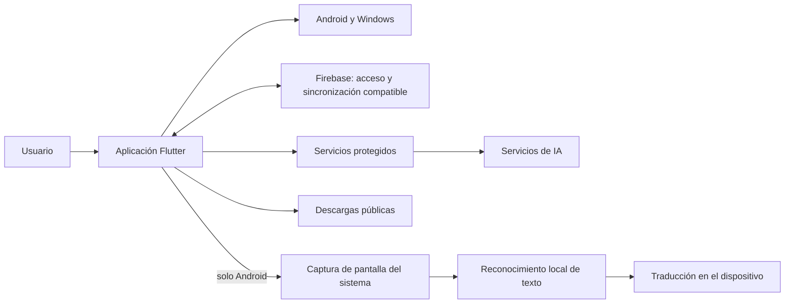

# ARK IA

### Un proyecto Flutter para Android y Windows

**Un espacio personal para IA, voz, notas y traducción de pantalla.**

[Deutsch](README.md) · [English](README.en.md) · [Español](README.es.md) · [Sitio del portafolio](https://zetadevofficial-creator.github.io/ARK-IA-Portfolio/) · [Página del producto](https://ark-ia.web.app/) · [Descargas](https://ark-ia.web.app/#descargas)

---

## El proyecto

ARK IA es una aplicación desarrollada de forma independiente. Reúne conversaciones con IA y herramientas de voz, organización personal y, en Android, traducción del texto en pantalla. Comenzó como una aplicación Kotlin y luego se llevó a Flutter para Android y Windows.

Este repositorio público es un **portafolio técnico y una presentación del proyecto**. Intencionalmente no incluye el código fuente completo ni la lógica privada del servidor.

La documentación se complementa con un [sitio de portafolio trilingüe](site/index.html), preparado para GitHub Pages. El selector ofrece alemán, inglés y español, y la página presenta capturas, arquitectura simplificada y una muestra seleccionada de Flutter.

Al habilitar GitHub Pages, GitHub Actions actualizará el sitio cuando cambien los archivos de `site/`.

## Funciones

- Conversaciones con IA y respuestas formateadas.
- Espacio personal para chats, carpetas, notas, listas y recordatorios.
- Dictado y lectura de respuestas en voz alta.
- Inicio de sesión y sincronización de los datos compatibles.
- Traducción de pantalla en Android: captura iniciada por el usuario, reconocimiento de texto y traducción local con modelos descargados.
- Publicaciones separadas para Android y Windows, con avisos de actualización en la app.

Algunas funciones dependen de la plataforma, los permisos, la conexión o los servicios disponibles. En esta versión, la traducción de pantalla está disponible solo en Android.

## Estado del proyecto

| Área | Estado |
| --- | --- |
| Versión de la app | 1.0.0 |
| Build de Android al preparar este portafolio | 29 |
| Plataformas objetivo | Android (ARM64) y Windows (escritorio) |
| Interfaz actual | Flutter y Dart; el proyecto comenzó como un prototipo en Kotlin |
| Carpetas principales | `lib/`, `android/`, `windows/`, `assets/`, `test/` y `tool/` |

El número de build es una referencia de este momento y se actualizará con futuras publicaciones.

## Vistas

  

Más capturas

  

  

## Vista técnica

El diagrama muestra límites generales entre componentes. No incluye rutas internas, formatos de datos, reglas de acceso ni detalles operativos privados.

La [nota técnica sobre la traducción de pantalla](docs/TECHNISCHE-FALLSTUDIE.md) presenta una decisión de diseño específica de Android, sin publicar la lógica central. El [proceso de desarrollo](docs/DEVELOPMENT-PROCESS.md) explica la estructura general real del proyecto privado y cómo trabajo, sin exponer detalles internos.

## Código seleccionado

El paquete independiente [`examples/flutter_interaction/`](examples/flutter_interaction/) contiene un widget reutilizable de Flutter, una animación sutil al tocar y pruebas de widget. Muestra código real y acotado de interfaz; no incluye autenticación, sincronización ni servicios de IA. Puedes ejecutar sus pruebas con `flutter test` desde esa carpeta.

## Desarrollo y calidad

El proyecto se desarrolla con Flutter y Dart. La aplicación privada separa configuración, modelos, pantallas, servicios, widgets, tema y utilidades. Las integraciones de Android y Windows están en sus áreas de plataforma. Para los cambios utilizo formato, análisis estático y pruebas automatizadas; publicaré resultados concretos solo después de volver a ejecutarlos localmente. El [proceso de desarrollo y la estructura](docs/DEVELOPMENT-PROCESS.md) explican estas prácticas.

## Qué no incluye este repositorio

- El código fuente completo de la aplicación ni el historial interno de todos los builds.
- Código de servidor, paneles de administración, APIs internas ni lógica de producto o cuotas.
- Claves de API, llaves de firma, tokens, credenciales de Firebase Admin ni archivos de configuración local.
- Builds locales, respaldos privados, datos de usuarios o de bases de datos.

Los instaladores públicos se encuentran en la [página de ARK](https://ark-ia.web.app/#descargas). El código fuente Flutter permanece en un repositorio privado.

## Enlaces

- [ARK IA — página y descargas](https://ark-ia.web.app/)
- [Instaladores públicos](https://github.com/zetadevofficial-creator/ARK-IA-Releases/releases)

---

**Desarrollado por Zeta-Dev · Guatemala**

