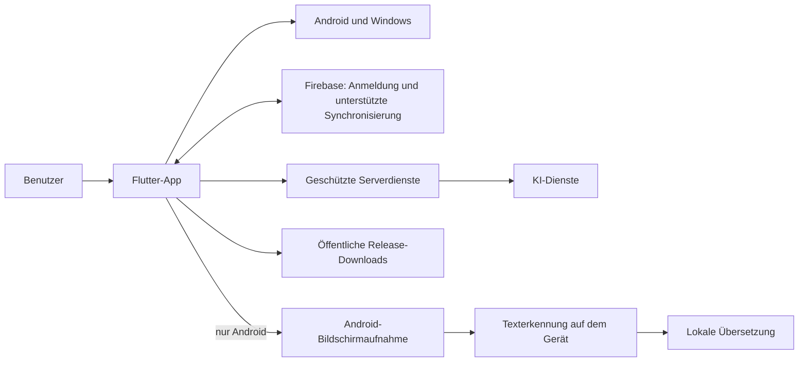

# ARK IA

### Ein Flutter-Projekt für Android und Windows

**Ein persönlicher Arbeitsbereich für KI, Sprache, Notizen und Bildschirmübersetzung.**

[Deutsch](README.md) · [English](README.en.md) · [Español](README.es.md) · [Produktseite](https://ark-ia.web.app/) · [Downloads](https://ark-ia.web.app/#descargas)

---

## Das Projekt

ARK IA ist eine von einer Einzelperson entwickelte Anwendung. Sie verbindet KI-Unterhaltungen mit Werkzeugen für Sprache, persönliche Organisation und – auf Android – die Übersetzung von Text auf dem Bildschirm. Das Projekt begann als Kotlin-App und wurde später auf Flutter für Android und Windows weiterentwickelt.

Dieses öffentliche Repository ist ein **technisches Portfolio und eine Projektdokumentation**. Es enthält bewusst weder den vollständigen App-Quellcode noch die private Serverlogik.

Eine dreisprachige [Portfolio-Webseite](site/index.html) ergänzt die Dokumentation. Der Sprachwähler bietet Deutsch, Englisch und Spanisch. Sie ist für GitHub Pages vorbereitet und zeigt Projektansichten, eine vereinfachte Architektur und ein ausgewähltes Flutter-Beispiel.

Die Seite wird nach dem Aktivieren von GitHub Pages über GitHub Actions bei Änderungen an `site/` automatisch aktualisiert.

## Funktionen

- KI-Unterhaltungen mit formatierten Antworten und verfügbaren Modellen.
- Persönlicher Bereich für Chats, Ordner, Notizen, Listen und Erinnerungen.
- Spracheingabe und Vorlesen von Antworten.
- Anmeldung und Synchronisierung der unterstützten Kontodaten.
- Android-Bildschirmübersetzung: auf Wunsch ausgelöste Aufnahme, Texterkennung und lokale Übersetzung mit heruntergeladenen Sprachmodellen.
- Getrennte Veröffentlichungen für Android und Windows mit Update-Hinweisen in der App.

Einige Funktionen hängen von Plattform, Berechtigungen, Internetverbindung oder verfügbaren Diensten ab. Die Bildschirmübersetzung ist in dieser Version nur für Android vorgesehen.

## Projektstand

| Bereich | Stand |
| --- | --- |
| App-Version | 1.0.0 |
| Android-Build beim Erstellen dieses Portfolios | 29 |
| Zielplattformen | Android (ARM64) und Windows (Desktop) |
| Aktueller UI-Stack | Flutter und Dart; das Projekt begann als Kotlin-Prototyp |
| Gezeigte Codebereiche | `lib/`, `android/`, `windows/`, `assets/`, `test/` und `tool/` |

Die Build-Nummer ist eine Momentaufnahme und wird bei späteren Releases aktualisiert.

## Einblicke

  

Weitere Ansichten

  

  

## Technischer Überblick

Das Diagramm zeigt nur die groben Systemgrenzen. Es dokumentiert keine internen Endpunkte, Datenformate, Berechtigungsregeln oder Betriebsgeheimnisse.

Eine ausführlichere, aber weiterhin öffentliche Beschreibung einer plattformspezifischen technischen Herausforderung steht in der [Fallstudie zur Bildschirmübersetzung](docs/TECHNISCHE-FALLSTUDIE.md). Der [Entwicklungsablauf](docs/DEVELOPMENT-PROCESS.md) erklärt außerdem die tatsächliche grobe Struktur des privaten Projekts und meinen Arbeitsprozess, ohne interne Implementierungsdetails offenzulegen.

## Ausgewähltes Codebeispiel

Das eigenständige Beispielpaket [`examples/flutter_interaction/`](examples/flutter_interaction/) enthält eine wiederverwendbare Flutter-Komponente mit einer dezenten Tipp-Animation und Widget-Tests. Es zeigt echten, begrenzten UI-Code und enthält weder Authentifizierung noch Synchronisierung oder KI-Dienste. Die Tests lassen sich mit `flutter test` in diesem Ordner ausführen.

## Entwicklung und Qualität

Das Projekt wird in Flutter und Dart entwickelt. Die private App trennt Konfiguration, Datenmodelle, Ansichten, Dienste, Widgets, Design und Hilfsfunktionen. Android- und Windows-Integrationen liegen in ihren jeweiligen Plattformbereichen. Für Änderungen verwende ich Formatierung, statische Analyse und automatisierte Tests; konkrete Ergebnisse werden erst nach einem erneuten lokalen Lauf als Nachweis veröffentlicht. Die Portfolio-Qualitätspraktiken sind in [Entwicklungsablauf und Projektstruktur](docs/DEVELOPMENT-PROCESS.md) beschrieben.

## Was dieses Repository nicht enthält

- Den vollständigen Quellcode der App oder die vollständige Historie interner Builds.
- Servercode, Administrationsoberflächen, interne APIs oder Produkt-/Kontingentlogik.
- API-Schlüssel, Signaturschlüssel, Tokens, Firebase-Admin-Zugänge oder lokale Konfigurationsdateien.
- Lokale Build-Ausgaben, private Backups, Benutzer- oder Datenbankdaten.

Die öffentlichen Installationsdateien sind über die [ARK-Produktseite](https://ark-ia.web.app/#descargas) erreichbar. Der Flutter-Quellcode bleibt in einem privaten Repository.

## Links

- [ARK IA – Produktseite und Downloads](https://ark-ia.web.app/)
- [Öffentliche Installationsdateien](https://github.com/zetadevofficial-creator/ARK-IA-Releases/releases)

---

**Entwickelt von Zeta-Dev · Guatemala**

